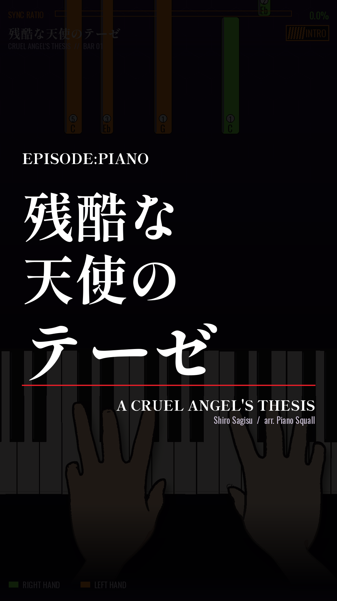
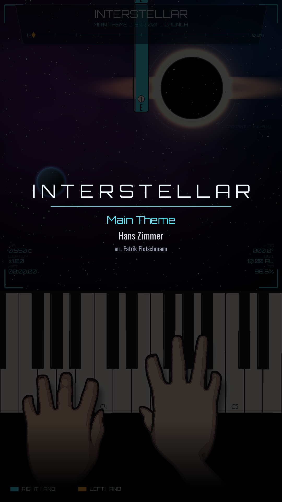

# music-tutor

This is the **music tutor** skill that turns sheet music into audio and portrait falling-note piano tutorial videos with cartoon Blender hands.

## Overview

This skill takes sheet music (image/PDF) or song names and renders them as:
- **Audio**: Using mido + FluidSynth (FluidR3_GM soundfont) with ffmpeg loudnorm processing
- **Piano tutorial videos**: Falling-note visualization with toon 3D hands rendered in Blender 4.5 Cycles

## Folder Structure

- **`SKILL.md`**: Complete skill documentation with setup instructions, workflow, and API reference
- **`examples/`**: Reference implementations (Axel F example) with `make.py`, `piano.py`, `video.py`, and `cello_video.py`
- **`scripts/eva/`**: Python render/compose scripts for the EVA theme
- **`scripts/interstellar/`**: Python render/compose scripts for the Interstellar theme

## Requirements

- FluidSynth with FluidR3_GM soundfont
- Blender 4.5 (Cycles renderer)
- Python packages: mido, cairosvg, pdf2image
- ffmpeg for audio normalization
- poppler-utils for PDF processing

See `SKILL.md` for detailed setup and usage instructions.

## Example Stills

Sample frames from tutorial videos rendered with different themes:

### Evangelion Theme

**Additional stills:**
- `examples/stills/evangelion/still_chorus.png`
- `examples/stills/evangelion/still_runup.png`

### Interstellar Theme

**Additional stills:**
- `examples/stills/interstellar/still_bar25.png`
- `examples/stills/interstellar/still_bar30.png`
- `examples/stills/interstellar/still_bar100.png`
- `examples/stills/interstellar/still_bar101.png`
